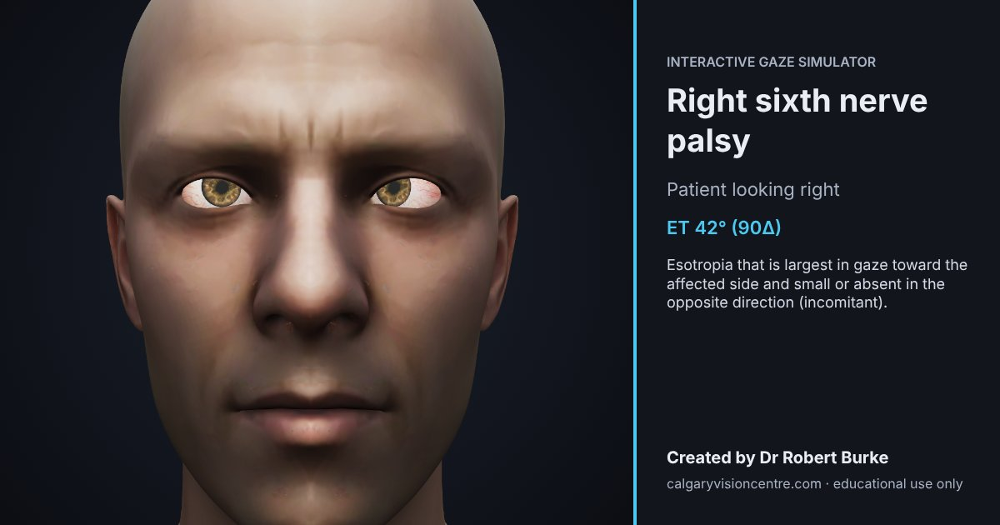

# Interactive Gaze Simulator

A free, browser-based 3D teaching model of the six extraocular muscles, cranial nerves III, IV and VI, and the pupils.
Move the fixation target, apply a nerve palsy or another motility disorder, and compare both eyes in the nine diagnostic positions of gaze. Then examine the pupils with a penlight, a swinging flashlight test, the room lights and diagnostic drops.

Created by **Dr Robert Burke**, optometrist, Calgary Vision Centre.



## What it does

- **Nineteen cases.** Eye movements: normal, third, fourth and sixth nerve palsy, cavernous sinus syndrome, internuclear ophthalmoplegia, thyroid eye disease, orbital floor fracture, Brown syndrome, Duane syndrome (type I), myasthenia gravis, Miller Fisher syndrome, and skew deviation (Wallenberg). Pupils: relative afferent pupillary defect, Horner syndrome, Adie tonic pupil, Argyll Robertson pupils, pharmacological dilation and physiological anisocoria. Each can be applied to the right, left or both eyes where that makes clinical sense.
- **Teaching card per case** with what to look for, clinical signs, red flags and what the model does not show.
- **Nine diagnostic positions** from a 3×3 pad or keys 1–9, laid out as the examiner sees the patient. The pointer or a finger also moves the target.
- **Manual nerve control:** cycle each CN III, IV and VI between normal, paresis and palsy.
- **Fixing eye switch** to show primary vs secondary deviation (Hering's law), a **near target** to show convergence and the near pupil response, and a **hold-to-compare** view of a healthy patient.
- **Pupil exam:** a room-light slider from bright to lights off (the mouse wheel works over the slider; a Lights off/on switch and the D key flick the lights), a penlight on either eye or swinging between them (tap the lit eye's button again to turn it off), and drops in both eyes (pilocarpine 0.1% and 1%, apraclonidine 0.5%). A live readout gives both pupil diameters. Each pupil case, plus the third nerve palsy and the normal case, has a **Run the key test** button that steps through the examination with captions.
- **Live readouts:** effort and force for every muscle, and the deviation in degrees and prism dioptres.
- **Motility chart → suggested diagnosis:** record the nine cardinal positions by dragging each eye in a 3×3 grid of close-up views, press Enter, and get the conditions that best reproduce the chart, with fit percentages and usual causes (`diagnose.js`). Boxes you don't touch count only weakly as normal, and common conditions get a slight head start over rare ones. Charts are shareable links too.
- **Shareable state:** the address bar always encodes the current case, gaze and pupil exam, e.g. `#case=cn6&side=R&gaze=4` or `#case=horner&side=R&room=0`. "Copy link" and "Save image" (a labelled 1200×630 PNG) are in the header.

## Companion page: the Neurolens embed

`neurolens.html` is a patient-facing page embedded on the clinic's Neurolens page (layout and embed code in `docs/neurolens-embed.md`). A click-through story on the 3D face explains that an eye drifts to its resting position whenever it isn't being used:

- **Cover test, hands on:** the visitor drags a solid paddle over an eye and clicks it to peek through an X-ray window; the covered eye has drifted. Covering the other eye swaps the roles. Then they try it on themselves, covering each eye in turn while looking at a red dot: if it jumps, their own eye's resting position wasn't straight.
- **Saccades:** the brain switches off the eyes' input during each jump (with the across-the-room and mirror-versus-phone-camera exercises), so both eyes start to drift and land slightly out of line.
- **Reading:** a chain of saccades across a see-through card, at full speed (150 words a minute, true size) where it looks normal, and slowed and magnified where the miss after each jump (fixation disparity) shows.
- **Inside the head:** the head turns to its profile and the trigeminal nerve is drawn over it. Position sensors in the eye muscles report along the nerve to the brainstem; the nerve's other territories light up (forehead, cheeks, jaw and chewing muscles, the covering of the brain), and the upper neck nerves meet it at the top of the spinal cord. An hour of reading in time-lapse makes the nerve almost pulse. The eye muscles are light work for strong, tireless muscles, so the problem is framed as bandwidth: normal traffic from every eye movement, plus the extra from holding misaligned eyes in line and correcting them (a "Trigeminal traffic" meter shows both, a shared line, a download that never stops), and the symptoms thought to follow an overloaded nerve light up one area at a time.

Below the demonstration are the cause, effect and solution, a call to action and the clinic's Neurolens articles. Eye movements are exaggerated; `fixation.js` holds the model (tests in `tests/fixation.test.mjs`), `head3d.js` loads the shared 3D head and `nerves.js` draws the trigeminal nerve. The still diagram on the page (`img/trigeminal.webp`) is rendered from the same drawing by `tools/trigeminal-figure.mjs`.

## The model, honestly

This is a qualitative teaching model, not a biomechanical simulation (`engine.js`).

- Ductions are limited to physiological ranges (abduction 50°, adduction 45°, elevation 40°, depression 55°).
- **Paresis** (a weak muscle) and **restriction** (a tight muscle, as in thyroid eye disease, blowout fracture and Brown syndrome) are modelled separately, so restrictive cases limit movement away from the tight muscle instead of mimicking a palsy.
- Both eyes receive the same command, set by the **fixing eye**, so paralytic deviations are incomitant and larger when the paretic eye fixes.
- Vertical action shifts from the vertical recti in abduction to the obliques in adduction.
- **INO** and **skew deviation** act on supranuclear commands: INO spares convergence and shows abducting nystagmus; skew is comitant with full ductions.
- **Myasthenia** is fatigable: muscles weaken with sustained use and recover at rest.

- **Ptosis:** each eye has a lid (none, mild, marked, complete). A third nerve palsy shows marked ptosis by default, Horner syndrome a mild one, and myasthenic ptosis worsens with sustained upgaze. The lids are shells around each globe that the face hides outside the eye opening, and they follow the eyes in downgaze.
- **Pupils** (`pupil.js`): light from either eye reaches both Edinger–Westphal nuclei, so both pupils react to light in one eye, and a weak optic nerve (RAPD) weakens the response of both. The sphincter (third nerve) and dilator (sympathetic) are separate, so a Horner pupil is smallest relative to its fellow in dim light and redilates slowly, while a third nerve, Adie or drug-dilated pupil is most unequal in bright light. Reactions have a latency, constrict faster than they redilate, and partly escape under a steady light. The Adie pupil is tonic for near and supersensitive to dilute pilocarpine; Argyll Robertson pupils lose the light reflex but keep the near response. The pupil button in the nerve panel switches an eye between normal, small (sympathetic loss) and dilated (third nerve) pupils; from dilated, one tap gives a pupil-sparing third nerve palsy.

Not modelled: torsion, head tilt, saccade velocities and segmental iris palsy. Drops act over 30 to 45 minutes in clinic and are sped up. Displayed numbers are illustrative.

`tests/diagnose.test.mjs` charts each condition with simulated reading error and checks the matcher recovers it. `tests/engine.test.mjs` checks the clinical direction of every case in the nine positions (for example: sixth nerve esotropia is largest toward the affected side; a fourth nerve hypertropia grows down and in; thyroid eye disease gives hypotropia with limited elevation; INO converges normally at near). `tests/pupil.test.mjs` does the same for the pupils (for example: an RAPD leaves the pupils equal but both dilate when the light swings to the affected eye; Horner anisocoria grows in dim light and reverses with apraclonidine; pilocarpine 1% constricts a third nerve palsy pupil but not a drug-blocked one).

## Running it locally

The page uses ES modules, so it must be served over HTTP; opening `index.html` directly from disk will not work.

```
npx serve .
# or
python3 -m http.server
```

Then open the printed address. Run the model tests with `npm test` (Node 18 or later).

## Files

| File | Purpose |
|---|---|
| `index.html` | Page, layout, styles and the reference text below the simulator |
| `main.js` | 3D scene, input, user interface, deep links and image export |
| `engine.js` | The oculomotor model (pure functions, no 3D) |
| `pupil.js` | The pupil model: light and near reflexes, kinetics and drops (pure functions, no 3D) |
| `cases.js` | Case presets, teaching cards, usual causes and scripted pupil tests |
| `diagnose.js` | Motility chart matcher: candidate conditions, scoring, plain-language findings |
| `neurolens.html`, `neurolens.js` | Patient-facing embed for the clinic's Neurolens page |
| `fixation.js` | Resting position and fixation disparity model for that page (pure functions) |
| `head3d.js` | The 3D head as a reusable module, used by the Neurolens page |
| `nerves.js` | The trigeminal nerve drawn over the head in profile, for that page |
| `img/trigeminal.webp`, `tools/trigeminal-figure.mjs` | The still trigeminal nerve diagram on that page, and the script that renders it |
| `vendor/fonts/` | Poppins and Urbanist for the Neurolens page, matching the clinic site (SIL Open Font Licence) |
| `head_eyes_v2.glb` | Head and eye model (meshopt geometry, WebP textures, 320 KB) |
| `vendor/three/` | three.js r160 and the add-ons used, served locally (MIT licence) |
| `og-image.jpg`, `favicon.svg`, `apple-touch-icon.png` | Social preview and icons |
| `share-images/` | 1200×630 images for the condition pages in `docs/promotion-kit.md` |

## Deployment notes

- The simulator's canonical home is `https://calgaryvisioncentre.com/gaze`, the clinic page that embeds it. The social-preview image is served from GitHub Pages. See `docs/promotion-kit.md` for the Squarespace pages, embed code and outreach material.
- There are no third-party requests: no CDN, web fonts, cookies or analytics.

## Browser support

Any current browser with WebGL and ES modules: Chrome or Edge 89+, Safari 16.4+, Firefox 108+.

## Licence and assets

© Dr Robert Burke. All rights reserved unless a licence file says otherwise.
The head mesh is derived from an Epic Games MetaHuman asset; its use and redistribution are governed by Epic's licence terms.
three.js is MIT licensed (`vendor/three/LICENSE`).

## Disclaimer

Educational use only. This simulator does not examine or assess anyone's eyes and is not a diagnostic tool.
